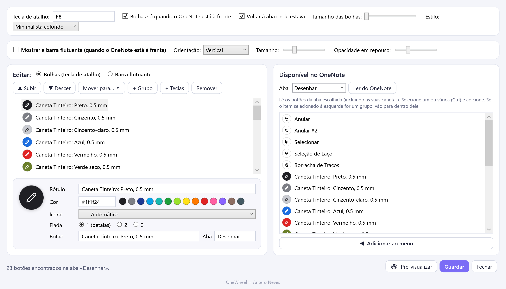

<h1 align="center">OneWheel</h1>

<b>Menu circular para trocar de caneta no OneNote, à volta da ponta da caneta.</b> 
Para Windows 10/11 e OneNote (Microsoft 365). Funciona com qualquer mesa digitalizadora, monitor com caneta ou rato.

## Descarregar e instalar

1. Em **[Releases](../../releases/latest)**, descarregue `Instalar-OneWheel.exe` e o `Manual-OneWheel.pdf`, que explica tudo com imagens.
2. Abra o instalador e escolha **Instalar**. Não é preciso ser administrador.
3. Abra o OneNote. Na primeira vez, o menu é montado sozinho com as canetas que lá tiver.
4. Prima **F8** com a caneta por cima da página.

> O ficheiro não tem assinatura digital. Se o Windows mostrar *«O Windows protegeu o PC»*, carregue em *Mais informações* e depois em *Executar mesmo assim*.

## O que faz

- **Pétalas e bolhas:** as ferramentas preferidas ficam em pétalas, coladas à ponta da caneta. As outras ficam em anéis de bolhas à volta (fiadas 1, 2 e 3).
- **Grupos:** por exemplo «Mais canetas», «Marcadores» e «Ferramentas». Há também atalhos de teclado, como anular.
- **Barra flutuante opcional:** fica translúcida em repouso e opaca quando a caneta passa por cima. Pode ser horizontal ou vertical, e os botões podem ser arrumados na própria barra.
- **Só atua com o OneNote à frente.** Nas outras aplicações, a tecla continua livre.
- **Três estilos:** minimalista, minimalista colorido e brilhante.
- **Português e inglês:** funciona com o OneNote nas duas línguas e com ecrãs com escalas diferentes.

&nbsp;&nbsp;
  

## Desinstalar

Em *Definições › Aplicações › Aplicações instaladas*, escolha **OneWheel › Desinstalar**. Também pode usar *Desinstalar…* no ícone junto ao relógio.

---

© Antero Neves. Todos os direitos reservados. O programa é gratuito para usar, e o código-fonte não é público.
